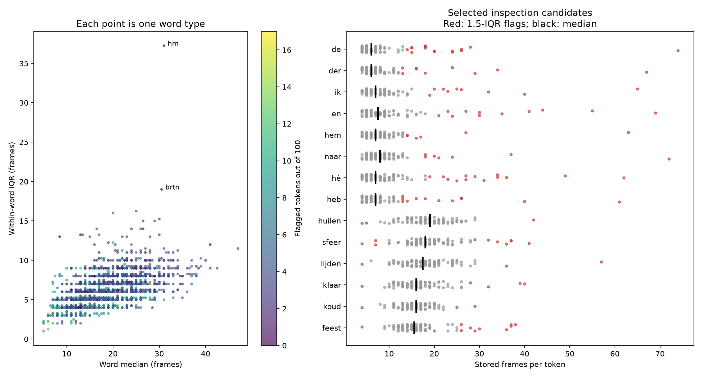

# CGN lexicon frame counts by word type

## Contents

1. [Per-word frame-count analysis](#method) ([overview plot](#overview),
   [long tokens](#unusually-long-tokens-relative-to-their-word),
   [short tokens](#unusually-short-tokens-relative-to-their-word),
   [variability](#word-types-with-the-largest-relative-variability),
   [inspection](#inspection-and-reproducibility)).
   Flags tokens whose stored frame count is unusual for their word type
   (4.73% of 246,600 tokens outside 1.5 × IQR) and lists the most extreme
   cases. These are inspection candidates, not confirmed errors.
2. [First-token frame-count outliers](#first-token-frame-count-outliers).
   Checks whether the first token of each word type (index 0) is an
   outlier: 132 of 2,466 types (5.35%), close to the 4.73% base rate.
3. [First-token flags and recorded retrieval scores](#first-token-flags-and-recorded-retrieval-scores).
   Compares those flags with single-query precision from
   [cgn_lexicon.md](cgn_lexicon.md): flagged words average 11.4%, others
   65.1%. This is exploratory and not a causal claim.

Source: `cgn_lexicon_frame_counts.json`, 2,466 word types and
246,600 tokens, with 100 tokens per type. All counts are positive integers.
Counts describe stored embedding rows, not independently verified acoustic
durations. The source does not record model, layer, frame stride or token keys.

## Method

Each token is compared with other tokens of the **same word type**.
A short outlier is below Q1 − 1.5 × IQR; a long outlier is above
Q3 + 1.5 × IQR. Values exactly on a fence are not flagged. Quartiles use
NumPy's linear interpolation. Outer fences at 3 × IQR provide a stricter
inspection subset. No word has zero IQR in this dataset.

This flags 11,663 tokens (4.73%):
251 short and 11,412 long, spread across
2,388 word types. Of these, 3,863 tokens also exceed an
outer fence. With 100 observations per word, an occasional flag is common;
the presence of any outlier does not establish a faulty word type.

These are inspection candidates, not confirmed alignment errors. Duration
distributions are asymmetric, and long tails may reflect legitimate prosodic
lengthening, reduction differences or annotation problems. The 0.1–1.5-second
selection window also truncates the distribution. Short-token detection is
particularly constrained by the four-frame floor observed in the data.

## Overview



The left panel compares word medians and within-word IQRs. Colour is the
number of flagged tokens, not retrieval accuracy. The right panel shows
tokens from selected extreme-ratio words; red points are flags and black
ticks are word medians. Jitter separates overlapping points and has no
substantive meaning.

## Unusually long tokens relative to their word

Prioritised by token count divided by its word median. Token indices are
zero-based positions in each word's original JSON list. For instance, index
14 is the fifteenth count for that word, not global index 14.

| Word | Token index (0-based) | Frames | Word median | Ratio |
| --- | ---: | ---: | ---: | ---: |
| de | 14 | 74 | 6 | 12.33 |
| der | 79 | 67 | 6 | 11.17 |
| ik | 23 | 65 | 7 | 9.29 |
| en | 70 | 69 | 7.5 | 9.20 |
| hem | 49 | 63 | 7 | 9.00 |
| naar | 61 | 72 | 8 | 9.00 |
| hè | 36 | 62 | 7 | 8.86 |
| heb | 63 | 61 | 7 | 8.71 |
| moet | 84 | 60 | 7 | 8.57 |
| daar | 47 | 66 | 8 | 8.25 |
| noem | 53 | 73 | 9 | 8.11 |
| een | 56 | 56 | 7 | 8.00 |
| he | 60 | 56 | 7 | 8.00 |
| hun | 20 | 56 | 7 | 8.00 |
| doet | 16 | 70 | 9 | 7.78 |
| on | 67 | 70 | 9 | 7.78 |
| me | 27 | 46 | 6 | 7.67 |
| het | 52 | 38 | 5 | 7.60 |
| in | 85 | 53 | 7 | 7.57 |
| zeg | 71 | 71 | 9.5 | 7.47 |

## Unusually short tokens relative to their word

| Word | Token index (0-based) | Frames | Word median | Ratio |
| --- | ---: | ---: | ---: | ---: |
| huilen | 76 | 4 | 19 | 0.21 |
| sfeer | 73 | 4 | 18 | 0.22 |
| lijden | 31 | 4 | 17.5 | 0.23 |
| klaar | 33 | 4 | 16 | 0.25 |
| koud | 24 | 4 | 16 | 0.25 |
| feest | 34 | 4 | 15.5 | 0.26 |
| huilen | 0 | 5 | 19 | 0.26 |
| aard | 79 | 4 | 15 | 0.27 |
| beide | 24 | 4 | 14.5 | 0.28 |
| boom | 84 | 4 | 14.5 | 0.28 |
| hout | 35 | 4 | 14.5 | 0.28 |
| vieren | 47 | 5 | 18 | 0.28 |
| boot | 38 | 4 | 14 | 0.29 |
| buurt | 93 | 4 | 14 | 0.29 |
| duren | 26 | 5 | 17.5 | 0.29 |
| muur | 45 | 4 | 14 | 0.29 |
| rijk | 66 | 4 | 14 | 0.29 |
| rijk | 96 | 4 | 14 | 0.29 |
| zuiden | 18 | 4 | 14 | 0.29 |
| effect | 36 | 5 | 17 | 0.29 |

## Word types with the largest relative variability

Ranked by sample standard deviation / mean (coefficient of variation),
which is sensitive to extremes. IQR is included as a more robust measure;
high variability alone is not evidence of error.

| Word | Median | Mean | Range | IQR | Short flags | Long flags |
| --- | ---: | ---: | --- | ---: | ---: | ---: |
| en | 7.5 | 10.95 | 4–69 | 6 | 0 | 11 |
| de | 6 | 8.91 | 4–74 | 3.25 | 0 | 16 |
| daar | 8 | 10.91 | 4–66 | 6.5 | 0 | 7 |
| der | 6 | 8.28 | 4–67 | 3 | 0 | 9 |
| een | 7 | 9.57 | 4–56 | 4.25 | 0 | 13 |
| hè | 7 | 10.84 | 4–62 | 5 | 0 | 13 |
| heb | 7 | 8.67 | 4–61 | 3 | 0 | 12 |
| ik | 7 | 9.44 | 4–65 | 4.25 | 0 | 9 |
| is | 7 | 9.27 | 4–45 | 4 | 0 | 9 |
| naar | 8 | 9.25 | 4–72 | 4 | 0 | 7 |
| ah | 11 | 14.82 | 4–71 | 9 | 0 | 12 |
| je | 7.5 | 11.40 | 4–52 | 8 | 0 | 9 |
| nou | 9 | 12.04 | 4–54 | 8 | 0 | 9 |
| me | 6 | 7.93 | 4–46 | 2 | 0 | 17 |
| doet | 9 | 11.01 | 4–70 | 5 | 0 | 9 |
| hun | 7 | 8.69 | 4–56 | 3 | 0 | 8 |
| he | 7 | 9.50 | 4–56 | 4.25 | 0 | 9 |
| we | 7 | 10.08 | 4–44 | 7 | 0 | 10 |
| als | 8 | 10.44 | 4–55 | 4 | 0 | 6 |
| eens | 8.5 | 11.23 | 4–61 | 8 | 0 | 4 |

### Broad central distributions

Ranked by IQR / median, which is less driven by isolated extremes than the
coefficient of variation. A broad or mixed distribution can have few or no
Tukey flags because its fences widen. In particular, `hm` has a median of
31 frames, IQR 37.25 and range 5–70, but no flagged tokens. This makes it
interesting to inspect despite passing the token-level screen. Acronyms
such as `cvp`, `vvd` and `vtm` also warrant checking for different spoken
realisations or annotation conventions; counts alone cannot establish these.

| Word | Median | Mean | Range | IQR | Short flags | Long flags |
| --- | ---: | ---: | --- | ---: | ---: | ---: |
| cvp | 8.5 | 11.58 | 4–28 | 13 | 0 | 0 |
| hm | 31 | 32.14 | 5–70 | 37.25 | 0 | 0 |
| je | 7.5 | 11.40 | 4–52 | 8 | 0 | 9 |
| vvd | 7 | 10.14 | 4–51 | 7.25 | 0 | 5 |
| vtm | 13 | 14.65 | 4–33 | 13.25 | 0 | 0 |
| we | 7 | 10.08 | 4–44 | 7 | 0 | 10 |
| hu | 13.5 | 16.16 | 4–74 | 13.25 | 0 | 4 |
| be | 8.5 | 11.96 | 4–48 | 8.25 | 0 | 6 |
| eens | 8.5 | 11.23 | 4–61 | 8 | 0 | 4 |
| oh | 10 | 12.88 | 4–59 | 9 | 0 | 7 |
| nou | 9 | 12.04 | 4–54 | 8 | 0 | 9 |
| tja | 15 | 19.40 | 6–63 | 13 | 0 | 5 |

## Word types with the shortest and longest typical counts

These rankings describe between-word differences, not a second error flag.
Longer words naturally tend to have larger medians; no correction for
phoneme/syllable count or speaking rate is available in this JSON.

### Shortest medians

| Word | Median | Mean | Range | IQR | Short flags | Long flags |
| --- | ---: | ---: | --- | ---: | ---: | ---: |
| het | 5 | 7.32 | 4–38 | 2.25 | 0 | 10 |
| ie | 5 | 6.17 | 4–16 | 2 | 0 | 4 |
| te | 5 | 5.84 | 4–22 | 1 | 0 | 10 |
| the | 5 | 6.77 | 4–22 | 2.25 | 0 | 12 |
| de | 6 | 8.91 | 4–74 | 3.25 | 0 | 16 |
| den | 6 | 7.23 | 4–21 | 2.25 | 0 | 8 |
| der | 6 | 8.28 | 4–67 | 3 | 0 | 9 |
| die | 6 | 7.38 | 4–24 | 3 | 0 | 8 |
| er | 6 | 7.81 | 4–36 | 3 | 0 | 10 |
| hij | 6 | 7.61 | 4–24 | 3 | 0 | 11 |
| la | 6 | 8.00 | 4–42 | 3 | 0 | 7 |
| me | 6 | 7.93 | 4–46 | 2 | 0 | 17 |

### Longest medians

| Word | Median | Mean | Range | IQR | Short flags | Long flags |
| --- | ---: | ---: | --- | ---: | ---: | ---: |
| tweepersoonstenten | 47 | 47.78 | 28–73 | 11.5 | 0 | 3 |
| vanzelfsprekend | 42.5 | 43.00 | 28–69 | 9 | 0 | 3 |
| minister-president | 41 | 41.10 | 26–59 | 12 | 0 | 0 |
| negenennegentig | 41 | 40.86 | 27–66 | 9 | 0 | 2 |
| administratie | 40 | 40.60 | 27–61 | 10 | 0 | 1 |
| actualiteit | 39 | 41.44 | 23–70 | 10.25 | 0 | 7 |
| verantwoordelijkheid | 39 | 39.53 | 27–67 | 9.25 | 0 | 5 |
| communicatie | 38.5 | 38.54 | 25–73 | 9 | 0 | 1 |
| achtennegentig | 38 | 38.51 | 24–65 | 8.25 | 0 | 5 |
| geconfronteerd | 38 | 38.69 | 23–52 | 8 | 0 | 0 |
| omstandigheden | 38 | 38.70 | 23–71 | 9.25 | 0 | 1 |
| tegelijkertijd | 37.5 | 38.26 | 25–74 | 8.25 | 0 | 4 |

## Inspection and reproducibility

Start with the largest long-token ratios (`de`, `der`, `ik`, `en`) and the
smallest short-token ratios (`huilen`, `sfeer`, `lijden`). Check the actual
audio and word boundaries before excluding anything. To locate a token,
recover that word's source-key list in the same order as when the counts
were generated. The count alone cannot identify a token; a newly generated
or differently ordered index must not be assumed to preserve this mapping.

The source counts and complete [per-word analysis](../data/cgn_lexicon_frame_count_analysis.json)
are local JSON files ignored by Git. The analysis contains every word's
statistics, fences and flagged token positions, together with a source hash.
To regenerate the analysis and figure, and print the generated part of this
report to stdout, run:

```bash
python scripts/analyse_lexicon_frame_counts.py
```

The first-token sections below are not generated by the script.

## First-token frame-count outliers

The original CGN note specifies one query token per word, but the historical
selection of the first token has not been confirmed. Here, first means index
0 in each word’s list in `cgn_lexicon_frame_counts.json`; linking this to a
historical query requires checking source keys and ordering.

Of 2,466 word types, 132 (5.35%) have a first token outside the within-word
1.5-IQR fences: 129 long and three short. Of these, 47 (1.91% of word types)
also exceed the 3-IQR fences, all on the long side.

For comparison, across all 246,600 tokens, 4.73% exceed 1.5-IQR and 1.57%
exceed 3-IQR. These are descriptive rates, not a test of ordering effects.

### First tokens outside 3-IQR

aardige, agenten, andere, bedrag, begint, begrijpt, besteed, beter, bevoegdheden, boeiend, boek, buitenland, daarin, degene, er, erg, gedachte, hadden, harde, heb, helpen, hou, hout, internationaal, jeugd, jong, keren, kind, langzaam, meesten, nota, plannen, problemen, sommigen, sprake, studeren, treinen, uitdrukking, veertig, vertel, volk, wetsvoorstel, wist, zeventien, zeventig, zonder, zuiden.

### All first tokens outside 1.5-IQR

| Word | First-token frames | Word median | Direction | Also outside 3-IQR |
| --- | ---: | ---: | --- | --- |
| aandacht | 34 | 19 | long | no |
| aardige | 61 | 19 | long | yes |
| agenten | 43 | 20 | long | yes |
| ah | 31 | 11 | long | no |
| andere | 43 | 15 | long | yes |
| angst | 28 | 17 | long | no |
| bedrag | 72 | 19 | long | yes |
| begint | 44 | 16 | long | yes |
| begrijpt | 51 | 21 | long | yes |
| belangrijke | 53 | 26.5 | long | no |
| bent | 38 | 13 | long | no |
| besteed | 54 | 22 | long | yes |
| beter | 43 | 16 | long | yes |
| bevoegdheden | 63 | 31 | long | yes |
| blijkt | 22 | 14 | long | no |
| boeiend | 63 | 22 | long | yes |
| boek | 36 | 11 | long | yes |
| boodschap | 44 | 24 | long | no |
| bos | 25 | 14 | long | no |
| buitenland | 62 | 26.5 | long | yes |
| christelijke | 34 | 23 | long | no |
| daarin | 40 | 15 | long | yes |
| daaruit | 37 | 18.5 | long | no |
| degene | 43 | 19 | long | yes |
| denk | 24 | 10 | long | no |
| die | 17 | 6 | long | no |
| diepe | 23 | 12.5 | long | no |
| droom | 30 | 18 | long | no |
| eigen | 30 | 14 | long | no |
| elf | 26 | 13 | long | no |
| enige | 28 | 17 | long | no |
| er | 19 | 6 | long | yes |
| erg | 36 | 11 | long | yes |
| films | 35 | 17 | long | no |
| ge | 23 | 7 | long | no |
| gedachte | 51 | 23 | long | yes |
| gevoel | 34 | 18 | long | no |
| glas | 30 | 17 | long | no |
| goede | 21 | 12 | long | no |
| groei | 25 | 13 | long | no |
| hadden | 29 | 10 | long | yes |
| harde | 35 | 14 | long | yes |
| heb | 40 | 7 | long | yes |
| heel | 26 | 10 | long | no |
| heer | 26 | 11 | long | no |
| helpen | 59 | 19 | long | yes |
| herman | 38 | 18 | long | no |
| hoefde | 22 | 13 | long | no |
| honderden | 41 | 19 | long | no |
| hotel | 34 | 19 | long | no |
| hou | 24 | 9 | long | yes |
| hout | 47 | 14.5 | long | yes |
| hu | 56 | 13.5 | long | no |
| huilen | 5 | 19 | short | no |
| ingediend | 46 | 25 | long | no |
| internationaal | 65 | 34 | long | yes |
| je | 29 | 7.5 | long | no |
| jeugd | 36 | 17 | long | yes |
| jong | 38 | 13 | long | yes |
| kaart | 30 | 14 | long | no |
| keren | 55 | 17 | long | yes |
| kind | 47 | 12.5 | long | yes |
| lagere | 42 | 19 | long | no |
| langzaam | 55 | 23 | long | yes |
| leek | 18 | 11 | long | no |
| leerkracht | 44 | 26 | long | no |
| leuven | 31 | 15 | long | no |
| maart | 27 | 17 | long | no |
| makkelijk | 32 | 19 | long | no |
| meesten | 64 | 19 | long | yes |
| middelbare | 38 | 23 | long | no |
| middenveld | 42 | 21 | long | no |
| moeder | 29 | 15 | long | no |
| moeders | 32 | 18.5 | long | no |
| moet | 21 | 7 | long | no |
| momenteel | 51 | 26 | long | no |
| namen | 33 | 18 | long | no |
| niemand | 36 | 19 | long | no |
| nog | 17 | 7.5 | long | no |
| nogmaals | 49 | 24 | long | no |
| nota | 52 | 16 | long | yes |
| of | 12 | 7 | long | no |
| om | 15 | 7 | long | no |
| plannen | 46 | 15 | long | yes |
| probeert | 40 | 18 | long | no |
| problemen | 60 | 25 | long | yes |
| reizen | 35 | 19 | long | no |
| rode | 20 | 14 | long | no |
| scholen | 47 | 19 | long | no |
| sommigen | 62 | 19 | long | yes |
| sprake | 47 | 21 | long | yes |
| spullen | 28 | 17 | long | no |
| steken | 40 | 20 | long | no |
| studenten | 46 | 26 | long | no |
| studeren | 73 | 27 | long | yes |
| telt | 23 | 13 | long | no |
| tenminste | 46 | 20 | long | no |
| treinen | 30 | 17 | long | yes |
| uitdrukking | 55 | 29 | long | yes |
| uitgesproken | 19 | 36 | short | no |
| valt | 31 | 12 | long | no |
| veertig | 59 | 20 | long | yes |
| verdere | 35 | 17 | long | no |
| verdriet | 38 | 22 | long | no |
| vertel | 47 | 17 | long | yes |
| vertelt | 31 | 20 | long | no |
| vieren | 32 | 18 | long | no |
| volk | 34 | 15 | long | yes |
| volwassenen | 49 | 29 | long | no |
| vreemde | 31 | 19 | long | no |
| waard | 27 | 14 | long | no |
| waarop | 24 | 13 | long | no |
| wapens | 40 | 21 | long | no |
| wat | 17 | 8 | long | no |
| weer | 22 | 8 | long | no |
| weinig | 28 | 16 | long | no |
| wel | 18 | 9 | long | no |
| weliswaar | 37 | 23 | long | no |
| wetsvoorstel | 57 | 32 | long | yes |
| wim | 18 | 9 | long | no |
| wist | 41 | 11.5 | long | yes |
| wonen | 37 | 18 | long | no |
| wordt | 18 | 8 | long | no |
| zacht | 28 | 16 | long | no |
| zegt | 6 | 11 | short | no |
| zeventien | 58 | 26 | long | yes |
| zeventig | 62 | 26 | long | yes |
| zicht | 27 | 14 | long | no |
| zijn | 26 | 10 | long | no |
| zonder | 42 | 16.5 | long | yes |
| zuiden | 50 | 14 | long | yes |
| zulke | 25 | 15 | long | no |

Flags identify inspection candidates, not confirmed alignment errors.

## First-token flags and recorded retrieval scores

Source scores: [cgn_lexicon.md](cgn_lexicon.md). Flags: the first-token outliers above.

### Scope

This is an exploratory comparison of word types: the first count in each word’s frame-count list is compared with that word’s recorded single-query precision. It has not been established that the historical query was that same token. Repository history contains no code selecting the historical single-query examples. Saved query results and indexes are currently available only remotely, so query identity cannot be confirmed locally.

The note provides 526 unique word scores after deduplicating table rows and adding its perfect-score list. The heading says 237 perfect words, but the actual list contains 236. All repeated table scores agree. The note deliberately contains best, middle and worst examples, so this is not a representative sample of all 2,466 types. No population effect or significance claim is made.

### Descriptive comparison

| First-token criterion | Flagged words with scores | Mean precision, flagged | Other documented words | Mean precision, others |
| --- | ---: | ---: | ---: | ---: |
| 1.5-IQR | 21 | 11.43% | 505 | 65.07% |
| 3-IQR | 10 | 10.00% | 516 | 63.95% |

Of the 21 matched 1.5-IQR words, 16 have precision zero and none has precision one. Among the other 505 documented words, 84 have precision zero and 236 have precision one. All 21 matched flags are long-token flags. Scores are associated with the word types; a token-specific attribution remains conditional on query identity.

### All flagged first-token words with documented scores

| Word | Recorded precision | First-token frames | Word median | Also outside 3-IQR |
| --- | ---: | ---: | ---: | --- |
| belangrijke | 0.0 | 53 | 26.5 | no |
| boeiend | 0.0 | 63 | 22 | yes |
| degene | 0.0 | 43 | 19 | yes |
| er | 0.0 | 19 | 6 | yes |
| glas | 0.0 | 30 | 17 | no |
| heb | 0.0 | 40 | 7 | yes |
| herman | 0.0 | 38 | 18 | no |
| jeugd | 0.0 | 36 | 17 | yes |
| lagere | 0.0 | 42 | 19 | no |
| middenveld | 0.0 | 42 | 21 | no |
| momenteel | 0.0 | 51 | 26 | no |
| nog | 0.0 | 17 | 7.5 | no |
| nogmaals | 0.0 | 49 | 24 | no |
| nota | 0.0 | 52 | 16 | yes |
| sommigen | 0.0 | 62 | 19 | yes |
| zeventig | 0.0 | 62 | 26 | yes |
| groei | 0.2 | 25 | 13 | no |
| internationaal | 0.2 | 65 | 34 | yes |
| bos | 0.4 | 25 | 14 | no |
| leek | 0.8 | 18 | 11 | no |
| zonder | 0.8 | 42 | 16.5 | yes |

### Interpretation

The documented subset shows an association between a first-token long-count flag and poor retrieval. It does not establish that duration caused the retrieval errors, that the flagged token was queried, or that pruning improves retrieval. Word identity, phonetic structure and the selection of examples may contribute.

For a stronger test, confirm the saved query order and the exact single-query selection by matching the note’s neighbour-label counts against the remote results. Then compare flagged versus unflagged queries across all tokens, preferably within word types and layers. Reference-only pruning with fixed queries is a separate test of whether extreme lexicon entries harm retrieval.

Related: [CGN lexicon results](cgn_lexicon.md),
[CGN lexicon plot](cgn_lexicon_plot.md).
