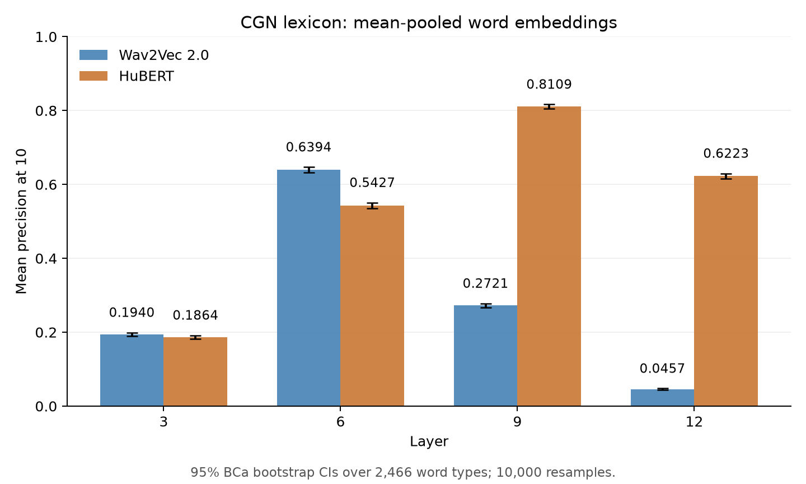

selected 2466 word types from cgn with minimally 100 word token (excluded components a,c,d,h,m,
excluded words shorter than .1 second and longer than 1.5 seconds)

This plot summarises the same CGN lexicon as [cgn_lexicon.md](cgn_lexicon.md),
evaluating all 100 tokens per word type rather than one token per word type.
Word embeddings used the centre frame of each word's embedding frames,
as implemented by `load_speech_vectors()` in [validate_lexicon.py](../validate_lexicon.py).
The exact generating run was not recorded, so the centre-frame method is inferred from the code.
The per-token and per-word precision calculations are in [analyse_results.py](../analyse_results.py).

## Mean-pooling results

Full mean-pooling results reported on 27 October 2026. Both query and
reference vectors use the mean of each token's stored word frames. Scores
are precision at 10 after excluding the query by source key.

| Model | Layer | Mean P@10 | Token-score standard deviation |
|---|---:|---:|---:|
| Wav2Vec 2.0 | 3 | 0.1940 | 0.2255 |
| Wav2Vec 2.0 | 6 | 0.6394 | 0.3359 |
| Wav2Vec 2.0 | 9 | 0.2721 | 0.2681 |
| Wav2Vec 2.0 | 12 | 0.0457 | 0.0942 |
| HuBERT | 3 | 0.1864 | 0.2261 |
| HuBERT | 6 | 0.5427 | 0.3381 |
| HuBERT | 9 | 0.8109 | 0.2977 |
| HuBERT | 12 | 0.6223 | 0.3412 |

Bars show the reported means. Error bars use the existing plotting helper's
formula, `1.96 * std / sqrt(n)`, assuming the complete lexicon of 246,600
tokens per layer. These approximate intervals use rounded summary values;
they are not reconstructed from raw scores and are not clustered by word
type or recording. They are very narrow at this sample size. The standard
deviations in the table describe token-score variability, not uncertainty
in the mean. With 100 tokens per type, the token-weighted mean equals the
mean of word-type averages.

HuBERT peaks at layer 9 (0.8109); Wav2Vec 2.0 peaks at layer 6 (0.6394).
The difference between their best layers is 17.15 percentage points.

Regenerate the PNG and [SVG](assets/cgn_lexicon_mean_pooling.svg) with
`python scripts/plot_cgn_lexicon_mean_pooling.py` from the repository root.
The script uses these reported summaries and does not rerun retrieval.

### Approximate comparison with the original centre-frame plot

| Layer | Centre pooling (approx.) | Mean pooling | Gain (percentage points) |
|---|---:|---:|---:|
| 3 | 0.125 | 0.1940 | 6.9 |
| 6 | 0.470 | 0.6394 | 16.9 |
| 9 | 0.220 | 0.2721 | 5.2 |

Centre pooling values are approximate readings from the plot below, so the
gains are approximate too. Mean pooling improves all three reported layers;
layer 6 remains strongest for Wav2Vec 2.0 and has the largest absolute gain
among these three layers. Exact centre-frame values for all layers and both
models have not been recovered here; the original plot remains the baseline.

## Original centre-frame plot

search is based on each item in the lexicon (100 items per word type, requested 10 nearest neighbours) \
per word score is average precision at 10 (average over 100 items) \
bar plot shows average precision over all word types and 95 % CI

