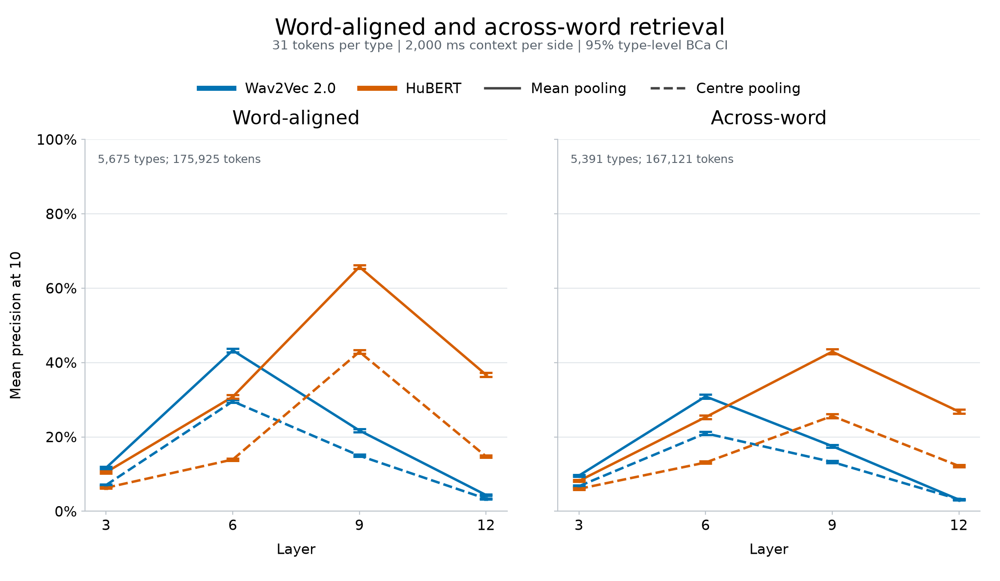

# CGN retrieval: updated 31-token selections



Recreated on 17 November 2026 using the completed remote neighbour results. The plot keeps the earlier figure's P@10 metric, model colours and pooling styles.

## Materials and scoring

- Word-aligned: 5,675 orthographic types and 175,925 tokens.
- Across-word: 5,391 phoneme-sequence types and 167,121 tokens.
- Exactly 31 tokens per type; queries exclude themselves.
- HuBERT and Wav2Vec 2.0, layers 3, 6, 9 and 12; mean and centre pooling.
- Embeddings have 2,000 ms context on each side.
- All materials are Netherlandic Dutch, components a,b,e,f,g,h,i,j,k,l,n,o.
- Both selections exclude simultaneous other-speaker speech and use inclusive 100-1500 ms bounds. Words use within_range assessments and exclude timing uncertainty. Across-word items require every phone to be within_range and share no selected source phones; no cross-boundary IQR filter is applied.

Each query score is the proportion of its ten nearest non-self neighbours sharing its label. The plotted estimate averages the 31 query scores within each type and then averages types equally. Uniform quotas make this identical to the mean over all queries.

Intervals are 95% BCa bootstrap intervals from 10,000 resamples of whole type means, using seed 20261029 and sorted type labels. The same resampling indices are reused across models, layers and pooling methods within each dataset. They describe uncertainty across types conditional on these tokens and the fixed indexes, not uncertainty from selecting new tokens or rebuilding the experiment.

## Best layers

Scores and intervals are percentages. Layers are selected from 3, 6, 9 and 12.

| Dataset | Model | Layer | Centre P@10 | Mean P@10 | Mean 95% CI |
|---|---|---:|---:|---:|---|
| Word-aligned | HuBERT | 9 | 42.88 | 65.72 | 65.19-66.26 |
| Word-aligned | Wav2Vec 2.0 | 6 | 29.57 | 43.27 | 42.74-43.79 |
| Across-word | HuBERT | 9 | 25.63 | 42.93 | 42.26-43.58 |
| Across-word | Wav2Vec 2.0 | 6 | 20.97 | 30.88 | 30.32-31.43 |

Word-aligned retrieval is higher in the best conditions, and the best model/layer is mean-pooled HuBERT layer 9 for both datasets. The comparison is descriptive: the inventories, token samples and phone-count distributions differ. The across-word type distribution has fewer long sequences: mean 5.428 phones, versus 5.890 for the word types' modal pronunciations.

The earlier figure used different inventories and 100 tokens per type. Changes in scores cannot be attributed to context collar alone.

## Files and reproduction

- [PNG](assets/lexicon_cross_boundary_20261117.png), [SVG](assets/lexicon_cross_boundary_20261117.svg), [PDF](assets/lexicon_cross_boundary_20261117.pdf).
- [All 32 point estimates and intervals, CSV](assets/lexicon_cross_boundary_20261117.csv).
- [Method, fingerprints and numeric summaries, JSON](assets/lexicon_cross_boundary_20261117.json).
- Compact per-type plotting input: local `svs_data/neighbour_type_means_20261117.npz`.
- Source: `/vol/mlusers/mbentum/fiemrok/lexicon_validation/neighbours/` on Fancypants.

The extraction checked every result's selection and label fingerprints, query counts and self-exclusion. Labels were recovered from the material store and validated against the saved label fingerprint. Only the existing neighbour arrays were scored; no retrieval or embeddings were recomputed.

From the local repository root:

```bash
../fiemrok_env/bin/python scripts/plot_cgn_lexicon_20261117.py \
    --data svs_data/neighbour_type_means_20261117.npz \
    --output notes/assets/lexicon_cross_boundary_20261117
```
