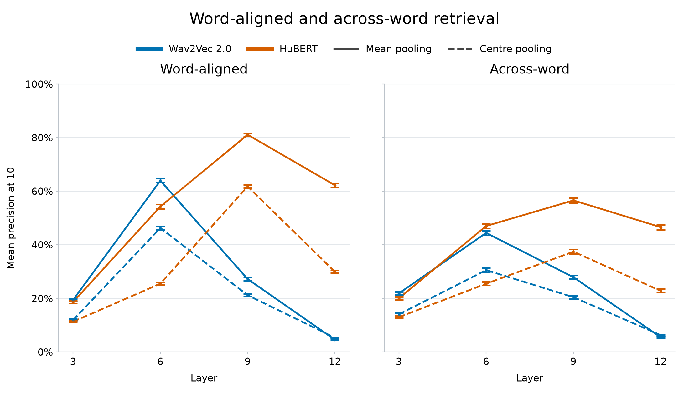

# Lexicon and cross-boundary retrieval results

Results downloaded from `fancypants.science.ru.nl` on 29 October 2026,
from `/vol/mlusers/mbentum/fiemrok/repo/svs_data/` into local `svs_data/`.
The two lexicon mean-pooling files were already present. The four
cross-boundary files and two lexicon centre-pooling files were downloaded.
All eight local files match the remote SHA-256 checksums.

## Metric and completeness

Values below are mean precision at 10 non-self neighbours, expressed as
percentages. Each token score is the fraction of ten retrieved neighbours
sharing its label. Lexicon labels are words; cross-boundary labels are
phoneme sequences. See [evaluation procedure](../data/cross_boundary_neighbours.md)
and [lexicon centre-pooling checks](../data/cgn_lexicon_center_frame.md).

All eight files contain layers 3, 6, 9, and 12. Every lexicon layer has
2,466 types and 246,600 token scores; every cross-boundary layer has
2,200 types and 220,000 scores. Each type has exactly 100 scores.
Type sets match across models, pooling methods, and layers within each
dataset. All scores are finite and within [0, 1]. Equal token counts mean
that averaging over tokens and averaging over type means give the same
result. These summaries do not rerun retrieval or verify source keys.

## Results across conditions

The plot shows 95% BCa bootstrap intervals from 10,000 resamples of type
means, with seed 20261029. Sorted type identities and the same random draws
are used across models, layers, and pooling methods within each dataset.
These intervals describe uncertainty across types, conditional on the token
sample and fixed retrieval index. They are intervals for individual means,
not intervals for condition differences.

Reproduce from the repository root with
`python scripts/plot_lexicon_cross_boundary.py`. Inputs default to local
`svs_data/`; use `--data-dir` to select another location. Outputs are
[PNG](assets/lexicon_cross_boundary_by_dataset.png),
[SVG](assets/lexicon_cross_boundary_by_dataset.svg), and
[PDF](assets/lexicon_cross_boundary_by_dataset.pdf).

Panels show **Word-aligned** (the lexicon sample) and **Across-word**
(the cross-boundary sample). Colours show model; solid circles show mean
pooling and dashed squares show centre pooling. Small translucent markers
and thicker error bars with wider caps keep the intervals visible.
Only this version is retained, in PNG, SVG, and PDF formats.

| Dataset | Model | Pooling | Layer 3 | Layer 6 | Layer 9 | Layer 12 |
|---|---|---|---:|---:|---:|---:|
| Lexicon | Wav2Vec 2.0 | centre | 11.89 | 46.27 | 21.18 | 5.31 |
| Lexicon | Wav2Vec 2.0 | mean | 19.40 | 63.94 | 27.21 | 4.57 |
| Lexicon | HuBERT | centre | 11.30 | 25.49 | 61.76 | 29.92 |
| Lexicon | HuBERT | mean | 18.64 | 54.27 | 81.09 | 62.23 |
| Cross-boundary | Wav2Vec 2.0 | centre | 14.06 | 30.55 | 20.46 | 6.28 |
| Cross-boundary | Wav2Vec 2.0 | mean | 21.86 | 44.43 | 27.89 | 5.51 |
| Cross-boundary | HuBERT | centre | 12.99 | 25.47 | 37.42 | 22.81 |
| Cross-boundary | HuBERT | mean | 20.01 | 47.00 | 56.56 | 46.56 |

## Interpretation

- HuBERT peaks at layer 9 for both pooling methods and datasets.
  Wav2Vec 2.0 peaks at layer 6 in all four corresponding conditions.
- The best lexicon result is HuBERT layer 9 with mean pooling (81.09%).
  The best cross-boundary result is the same model, layer, and pooling
  (56.56%). These exceed the best Wav2Vec results (63.94% and 44.43%)
  by 17.16 and 12.13 percentage points, respectively.
- Mean pooling improves every HuBERT layer. Its gains over centre pooling
  are 7.34, 28.79, 19.34, and 32.32 percentage points for lexicon layers
  3, 6, 9, and 12; the cross-boundary gains are 7.02, 21.52, 19.14,
  and 23.75 points.
- Mean pooling improves Wav2Vec layers 3, 6, and 9, with the largest gain
  at layer 6: 17.67 points for lexicon and 13.88 for cross-boundary.
  Layer 12 is the exception: mean pooling reduces scores by 0.73 and
  0.77 points, respectively. Wav2Vec layer 12 performs poorly throughout.
- Cross-boundary retrieval is lower at the strongest layers: compared
  with lexicon, mean-pooled cross-boundary scores are 19.51 points lower
  for Wav2Vec layer 6 and 24.53 points lower for HuBERT layer 9.
  The corresponding centre-pooling gaps are 15.72 and 24.34 points.
- This difference is not uniform across layers. Cross-boundary scores
  are slightly higher at layer 3 and for Wav2Vec layer 12; Wav2Vec
  layer 9 with mean pooling is also slightly higher (27.89% vs 27.21%).

The dataset comparison is descriptive: the type inventories, label
definitions, token samples, and retrieval indexes differ. It does not
isolate a causal effect of crossing a word boundary. No significance
tests or confidence intervals for condition differences were calculated.

## Local files

- `svs_data/cgn_lexicon_{w2v,hubert1}_{centre,mean}_results.json`
- `svs_data/cross_boundary_lexicon100_2200_{w2v,hubert1}_{center,mean}_results.json`

Braces above denote filename alternatives. Note the existing spelling
difference: lexicon uses `centre`, cross-boundary uses `center`.
`svs_data/` was already listed in `.gitignore`; downloaded results remain
local and untracked.
